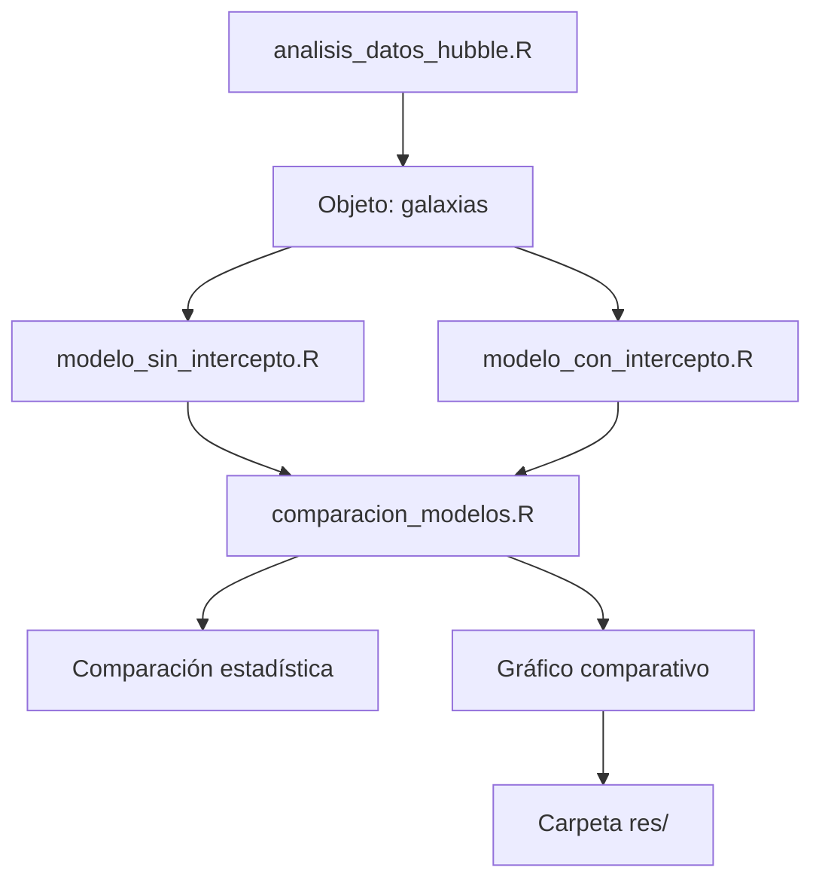

# Documentación de scripts

## 1. Estructura del código

Los scripts del proyecto se organizan de forma modular, separando la preparación de los datos, la estimación de los modelos y su comparación.

```text
Proyecto_Hubble/
│
├── cod/
│   ├── analisis_datos_hubble.R
│   ├── modelo_sin_intercepto.R
│   ├── modelo_con_intercepto.R
│   └── comparacion_modelos.R
│
├── res/
│   └── grafico_comparacion_modelos.png
│
├── referencias.bib
└── README.md
```

## 2. Descripción de los scripts

| Script | Funcionalidad |
|---|---|
| `analisis_datos_hubble.R` | Importa el conjunto de datos Hubble del paquete `gamair`, realiza la preparación de las variables y genera el objeto `galaxias`. |
| `modelo_sin_intercepto.R` | Ajusta el modelo lineal sin intercepto, estima la constante de Hubble, calcula su intervalo de confianza y genera el gráfico individual del modelo. |
| `modelo_con_intercepto.R` | Ajusta el modelo lineal con intercepto, estima sus coeficientes, calcula sus intervalos de confianza y genera el gráfico individual correspondiente. |
| `comparacion_modelos.R` | Integra los modelos anteriores, compara sus coeficientes, calcula las diferencias entre pendientes, realiza la prueba ANOVA y genera el gráfico comparativo. |

## 3. Flujo de ejecución

El procesamiento se desarrolla mediante cuatro etapas:



### Etapa 1. Preparación de los datos

Se carga la base de datos original y se preparan las variables necesarias para el análisis. El resultado es el objeto `galaxias`, que contiene las observaciones de distancia y velocidad de recesión.

### Etapa 2. Estimación independiente de los modelos

A partir del objeto `galaxias`, se ejecutan dos scripts independientes:

- **Modelo A:** regresión lineal sin intercepto.
- **Modelo B:** regresión lineal con intercepto.

Cada script genera su respectivo objeto de modelo y su representación gráfica.

### Etapa 3. Comparación de los modelos

El script `comparacion_modelos.R` incorpora los resultados de ambos modelos para desarrollar:

- Comparación de interceptos y pendientes.
- Diferencia absoluta y porcentual entre las pendientes.
- Contraste de modelos anidados mediante ANOVA.
- Representación gráfica conjunta de ambos ajustes.

### Etapa 4. Exportación de resultados

El gráfico comparativo se guarda automáticamente en la carpeta `res/`, con el nombre:

`grafico_comparacion_modelos.png`

## 4. Dependencias entre scripts

El proyecto utiliza la función `source()` para integrar los archivos y reutilizar los objetos generados.

El script de comparación incorpora los archivos necesarios mediante:

```r
source("cod/analisis_datos_hubble.R")
source("cod/modelo_sin_intercepto.R")
source("cod/modelo_con_intercepto.R")
```

De esta manera, no es necesario volver a escribir los procedimientos de preparación y estimación dentro del script de comparación.

## 5. Ejecución

Para ejecutar el análisis completo desde RStudio, se puede ejecutar directamente:

```r
source("cod/comparacion_modelos.R")
```

Este archivo carga automáticamente los datos y los dos modelos antes de realizar la comparación.

**Nota:** se requiere que las carpetas `cod/` y `res/` estén disponibles en el directorio de trabajo del proyecto.

## 6. Integración con Quarto

El documento principal `.qmd` utiliza los scripts anteriores mediante llamadas a `source()`, permitiendo incorporar los objetos estadísticos y gráficos directamente en el reporte.

Esto mantiene separados el código de procesamiento y el documento de presentación de resultados, facilitando su mantenimiento y actualización.
